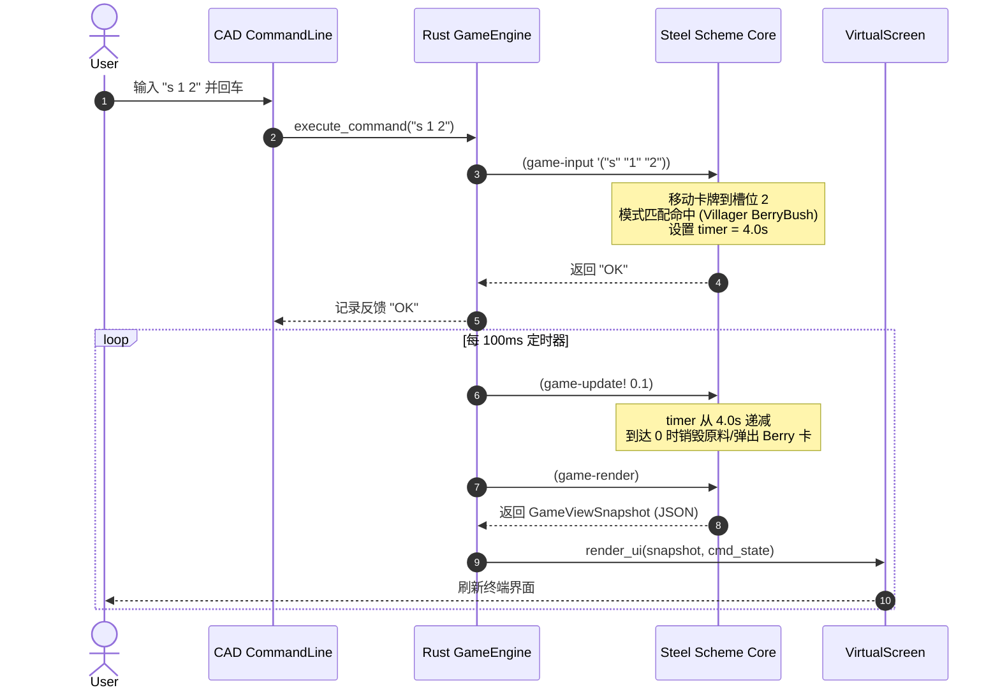

# CardCraft 系统架构设计文档 (Architecture Design Document)

本文档详细阐述 CardCraft 的系统架构、设计哲学、分层模型以及各子系统的工程实现。

---

## 一、 设计哲学与核心理念

CardCraft 旨在将《Stacklands》（堆叠大陆）的核心建造生存机制，通过纯字符终端、CAD 风格命令行与 Lisp 符号计算进行优雅表达。其底层架构建立在三大基石之上：

1. **沙漏模型（Narrow-Waist Architecture）**：
   * 宿主端（Rust）与解释器端（Steel Scheme）的交互接口极窄化，规避深层 FFI 绑定的内存管理风险。
2. **状态纯粹性（Scheme as the Single Source of Truth）**：
   * 所有世界实体（卡牌、卡栈、配方倒计时、货币、月相周期）100% 存在于 Scheme 内存中，Rust 不维护任何冗余的游戏业务状态。
3. **Headless 虚拟缓冲渲染（Decoupled Virtual Buffer）**：
   * UI 排版逻辑不直接耦合物理控制台，而是渲染到纯内存虚拟显存（Virtual Buffer），实现对多平台（Terminal、WASM、Web、CI 无头单测）的无缝支撑。

---

## 二、 整体分层架构

```
+-----------------------------------------------------------------------------+
|                           RUST 宿主层 (Host Shell)                           |
|                                                                             |
|  +---------------------+   +---------------------+   +-------------------+  |
|  | Crossterm Terminal  |   | CAD Command Manager |   | Fixed Tick Timer  |  |
|  | (Raw Mode / Input)  |   | (History / Cursor)  |   | (100ms Event Loop)|  |
|  +----------+----------+   +----------+----------+   +---------+---------+  |
|             |                         |                        |            |
+-------------|-------------------------|------------------------|------------+
              |                         |                        |
              | 键盘事件                | "s 1 2" CAD 指令       | dt = 0.1s
              v                         v                        v
+-----------------------------------------------------------------------------+
|                         狭窄接口层 (The Narrow Waist)                         |
|                                                                             |
|  * (game-input tokens)                                                       |
|  * (game-update! dt)                                                         |
|  * (game-render)            ===> Serde JSON Deserializer                     |
+-----------------------------------------------------------------------------+
              ^                         |                        |
              | 只读视图导出            | 状态变更               | 状态演进
              |                         v                        v
+-------------+---------------------------------------------------------------+
|                       STEEL SCHEME 逻辑引擎 (Guest Core)                    |
|                                                                             |
|  * World State: Moon, Gold, Card Limit, Stacks List                         |
|  * Recipe Pattern Matcher: Multiset Subset Algorithm                        |
|  * Action Primitives: stack, unstack, move, buy, open, sell, wait           |
|  * Survival Cycle: Monthly food consumption & starvation check              |
+-----------------------------------------------------------------------------+
                                        |
                                        v 只读快照渲染
+-----------------------------------------------------------------------------+
|                       HEADLESS 虚拟缓冲层 (Virtual Screen)                   |
|                                                                             |
|              GameViewSnapshot (Rust Semantic View-Model)                    |
|                                       │                                     |
|                                       ▼                                     |
|              Ratatui TestBackend (In-memory 2D Cell Grid)                   |
|                   │                                    │                    |
|                   ▼                                    ▼                    |
|         [本地物理控制台渲染]                 [自动化测试断言 / Web 投射]     |
|       (Crossterm stdout raw)                 (to_string() snapshot diff)    |
+-----------------------------------------------------------------------------+
```

---

## 三、 模块职责与详细实现

### 1. Scheme 逻辑核心 (`scripts/core.scm`)
Scheme 天然擅长处理嵌套列表与符号，非常适合做卡牌的栈操作。
* **数据结构**：
  * **Card**：以字符串表示的原子名称（`"Villager"`, `"Wood"`）。
  * **Stack**：六元组列表 `(id cards progress total-time recipe-name status)`。
  * **World**：全局状态变量，包含月相、倒计时、货币、卡栈列表与事件日志。
* **多重集配方模式匹配（Multiset Pattern Matcher）**：
  * `multiset-subset?` 递归检查当前栈中的卡牌多重集是否完全覆盖配方所需卡牌。
  * 当匹配成功，栈进入 `Crafting` 状态，挂载倒计时。
* **时间推进与生产结算 (`game-update!`)**：
  * 遍历各栈推进进度，达标后自动扣减原料卡（`multiset-diff`），并将产物（`rec-outputs`）通过 `spawn-card!` 自动弹出到新栈槽中。
  * 监测月末饥饿，自动遍历场上食物卡扣除。

### 2. Rust 宿主引擎封装 (`src/engine.rs`)
* 嵌入 `steel_core::steel_vm::engine::Engine`。
* 在初始化时直接将 `core.scm` 嵌入二进制静态编译（`include_str!`），保证零外部路径依赖。
* **双模解析分发**：
  * 普通文本（如 `s 1 2`）：拆解为 Token 列表，调用 `(game-input '("s" "1" "2"))`。
  * 括号开头（如 `(spawn-card! "Apple")`）：作为 Scheme 代码直接在 VM 内动态求值（内置开发调试控制台）。

### 3. CAD 交互控制状态机 (`src/cad.rs`)
* 维护用户当前输入的缓冲区、光标逻辑位置（支持 `Left`、`Right`、`Home`、`End`）。
* 维护历史命令栈，支持通过 `Up` / `Down` 键快速回溯执行过的指令。
* 接收来自引擎的执行反馈（Feedback），实时更新在命令栏标题中。

### 4. 虚拟缓冲与解耦渲染 (`src/buffer.rs` & `src/render.rs`)
* **`render_ui`**：采用声明式布局（Declarative Layout），将视图划分为：
  * **顶部信息条**：月相周期、天数进度条、食物消耗对比、黄金储备、卡牌数量上限警告。
  * **中央卡栈区**：每行一个独立卡槽，卡牌带 ANSI 专属色彩，右侧动态绘制 ASCII 进度条 `[====....]`。
  * **商店与快捷键**：卡包价格与快捷指令。
  * **日志区**：最近系统事件（生成物、交易、饥饿警告）。
  * **底部命令栏**：输入文本行与交互硬件光标同步。
* **`VirtualScreen`**：
  * 包装 Ratatui 的 `TestBackend`。
  * 提供 `to_string()` 方法，把纯内存 2D 字符网格按行提取为标准换行字符串，用于自动化测试与外部重定向。

---

## 四、 核心工作流与状态时序

### 1. 堆叠与生产时序图



---

---

## 七、 多协议并发服务与 Actor 桥接架构 (Multi-Protocol & Actor Bridge)

为了在支持多客户端（终端 TUI、单端口 Web/WebSocket、裸 TCP 命令行、Iroh P2P QUIC）高并发访问的同时，保障非线程安全（`!Send`）的 Steel Scheme 虚拟机的内存与执行安全，CardCraft 引入了 **Actor 并发模型**：

```
+-------------------------------------------------------------------------+
|                        GameEngine Actor 独立任务线程                      |
|                 (持有唯一 GameEngine 实例与 Steel Scheme VM)              |
+-------------------------------------------------------------------------+
                                     ^
                                     | tokio::sync::mpsc (EngineCommand)
                                     v
                  +-------------------------------------+
                  |      EngineHandle (Send + Sync)     |
                  +-------------------------------------+
                     /               |               \
                    v                v                v
       +-----------------+  +-----------------+  +-----------------+
       |   WebSocket     |  |   TCP Socket    |  |   Iroh P2P      |
       |  (Hybrid Port)  |  |  (Line-based)   |  |  (QUIC Stream)  |
       +--------+--------+  +--------+--------+  +--------+--------+
                |                    |                    |
                v                    v                    v
          [Web 浏览器]          [nc/脚本客户端]       [远端 P2P Peer]
```

### 1. 单端口 HTTP 网页与 WebSocket 复用技术
- 监听单一端口（如 8080），通过对握手数据包的特征检测（嗅探 `Upgrade: websocket` 请求头），实现普通 HTTP GET 请求自动返回静态页面，而 WebSocket 请求自动升级为实时全双工流。

### 2. P2P 本地桥接网络（Local P2P Web/TCP Bridge）
- 浏览器由于沙盒安全限制无法直接创建原生 UDP/QUIC 连接。CardCraft 客户端在运行 `cardcraft join <ticket>` 时，本地进程充当 **P2P 协议网关**，将本地 `ws://localhost:8080` 的请求透明封装并通过 Iroh QUIC 隧道转发至 Host，彻底打通第三方富前端。

---

## 八、 测试与质量保障策略

* **纯无头自动化测试（Zero-Headless CI）**：
  * `tests/headless_tests.rs` 包含 19 个端到端测试用例，覆盖全部基础玩法、Scheme 注入原语、沙盒安全、TCP/Web 服务以及 P2P 桥接全链路闭环验证。
* **内存隔离**：
  * 游戏实体对象生命周期完全受 Scheme 垃圾回收管理，Rust 层只读取无状态的 JSON 快照，从根源杜绝悬垂指针与内存泄露。


---

## 六、 离散时空坐标与多维扩展模型 (Spatiotemporal Evolution)

引擎将世界抽象为正交的离散物理模型：

1. **时间维（T 轴）与事件坐标**：
   * 采用逻辑增量 `(game-update! dt)` 代替现实时间戳，使整个游戏具备完美的**确定性、可暂停性、时间快进（Wait）与无头单测能力**。
2. **空间维（X 轴与 Z 轴）**：
   * 终端行代表 1D 空间槽位（Row），行内卡牌构成 Z 轴深度层级。
   * 通过 `Link`（空间管道）元语构建流水线拓扑，通过 `Zone`（手牌/战场/地牢）构建空间分区。
3. **世界上下文压栈（Dungeon Context Stack）**：
   * 支持通过场景压栈 `(push-scene! / pop-scene!)`，零成本实现进入深渊地牢、探索洞穴与携带战利品返程。
4. **多尺度信息缩放（LOD Viewports）**：
   * 支持宏观大地图（区域）、中观卡栈、微观卡牌属性的三级层级缩放。

> 📖 **深入阅读**：完整的 8 大衍生游戏品类（异星工厂、杀戮尖塔、塔防、经典地牢、烹饪大亨等）详细设计与落地思路，请参阅专门的技术专论文档：**[docs/GAME_EXTENSIONS.md](GAME_EXTENSIONS.md)**。
