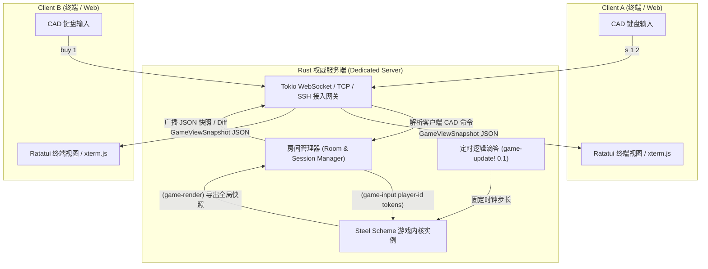

# CardCraft 网络版架构设计方案 (Networked CardCraft Architecture)

本文档阐述如何将单机版 **CardCraft** 平滑升级为高并发、跨平台的网络多人对战/合作游戏。

由于 CardCraft 采用了 **“狭窄接口层 (The Narrow Waist)”** 与 **“无头虚拟缓冲 (Headless Virtual Buffer)”** 设计，游戏内核与渲染表现层已实现了 100% 解耦，使网络化重构极其优雅高效。

> [!NOTE]
> 关于网络通信 7 大底层接口详解以及公屏聊天、私聊密语、房间隔离、天梯匹配、自由交易行的完整 Scheme 源码实现，请参阅专题技术指南：[NETWORK_MODULE.md](NETWORK_MODULE.md)。

---

## 一、 为什么 CardCraft 天生是“网络原生”的？

在传统游戏引擎中改造网络版往往需要重构大量的对象生命周期和图形管线，但 CardCraft 具备以下三大天生网络化优势：

1. **确定性状态机与事件坐标**：
   * 引擎推进完全依赖 `(game-update! dt)`，而非本地现实系统时间戳。所有随机数与时间演进均是确定性的。
2. **纯文本命令流输入 (`game-input`)**：
   * 玩家的操作全部为极低带宽消耗的原子文本 Token（如 `s 1 2`、`buy 1`、`wait`），上行数据包体积仅有几个字节。
3. **只读状态快照与无头渲染 (`game-render`)**：
   * 引擎导出的 `GameViewSnapshot` 是纯数据 JSON。客户端只需负责将该 JSON 喂给 `render_ui` 并在终端绘制，客户端**完全不需要运行 Scheme 虚拟机**。

---

## 二、 系统总体架构 (Client-Server Architecture)

采用 **权威服务器 (Authoritative Server) + 瘦客户端 (Thin Client)** 模型：



---

## 三、 客户端的三种落地形态

得益于前后端分离，网络版可以同时支持三种不同的客户端形态：

| 客户端类型 | 实现机制 | 优势 | 适用场景 |
| :--- | :--- | :--- | :--- |
| **1. 原生 TUI 客户端** | 基于现有的 `src/render.rs`，去掉 Scheme 引擎，换成 WebSocket 连接 | 原汁原味的终端体验，体积 < 5MB | 桌面终端极客玩家 |
| **2. SSH 即开即玩 (Zero-Install)** | 服务端运行 `russh` 库，玩家在终端执行 `ssh play.cardcraft.net` 即可连接 | **零安装**，支持任何手机/平板/电脑终端 | 公共服务器、黑客马拉松演示 |
| **3. Web 网页客户端** | 浏览器端基于 `xterm.js` 或纯 HTML5 DOM 渲染快照 | 零门槛分享，发送 URL 即可联机 | 社交平台推广、好友联机 |

---

## 四、 核心网络交互协议

### 1. 上行数据帧 (Client $\to$ Server)
客户端发送轻量 JSON 或纯文本：
```json
{
  "type": "cmd",
  "seq": 104,
  "cmd": "s 1 2"
}
```

### 2. 下行数据帧 (Server $\to$ Client)
服务端在每个周期（如 100ms 聚合一次，或有状态变更时）广播：
```json
{
  "type": "sync",
  "tick": 450,
  "snapshot": {
    "moon": 1,
    "moon_progress": 0.35,
    "gold": 25,
    "card_count": 8,
    "max_cards": 20,
    "stacks": [
      {
        "id": 1,
        "cards": ["Villager", "Sword"],
        "progress": 0.0,
        "total_time": 0.0,
        "status": "Idle",
        "owner": "alice"
      }
    ],
    "logs": ["[alice] 装备了铁剑"]
  }
}
```

> [!TIP]
> 性能优化：对于带宽敏感环境，可采用 JSON Patch (RFC 6902) 或紧凑的二进制协议（Bincode / MsgPack），将单次下行网络流量压至数十字节以内。

---

## 五、 三大多人玩法模式设计

### 1. 合作共建模式 (Co-op Village)
* **玩法机制**：所有玩家共享同一个村庄与卡槽空间。
* **分工协作**：
  * Player 1（农夫）：负责浆果、小麦的采集与月末口粮供给。
  * Player 2（铁匠/建筑师）：负责木材、石材的深加工与防御工事。
* **互斥与冲突处理**：
  * 卡槽增加轻量锁定机制：当某位玩家正在对槽位 3 进行操作时，临时标记 `[3: LOCKED BY BOB]`，操作提交后立即解锁。

### 2. PvP 城堡对攻与恶魔召唤 (Lane Battler)
* **玩法机制**：
  * 分屏显示：左侧为本方领地（槽位 1~10），右侧为对手领地（槽位 11~20）。
  * 玩家在己方领地运营经济，合成出攻击型单位（如哥布林、投石机、灾厄卡牌）。
  * 新增 CAD 原语：`attack <from_row> <target_player>` 或 `send 4 opponent`，将灾害卡或攻城怪强行推入对方阵地，迫使对方月末扣血或消耗防守力量。

### 3. 全局自由交易集市 (Cross-Island Bazaar)
* **玩法机制**：
  * 每个玩家经营自己的独立小岛，互不干扰生产空间。
  * 存在公共世界槽位或拍卖行，玩家使用指令上架商品：
    * `list 2 5`：将槽位 2 的卡牌以 5 金币挂单上架。
    * `trade buy <order_id>`：跨岛购买心仪的稀缺配方卡。

---

## 六、 引擎代码改造步骤（仅需三步）

### 步骤 1：Scheme 逻辑扩展玩家标识
在 `scripts/core.scm` 中，将 `(game-input tokens)` 升级为多玩家支持：
```scheme
(define (game-input player-id tokens)
  (let ((cmd (car tokens)))
    (cond
      ((string=? cmd "s")
       ;; 增加对卡栈所有权或操作权的鉴权
       (do-player-stack! player-id (list-ref tokens 1) (list-ref tokens 2)))
      ...)))
```

### 步骤 2：Rust 服务端集成 Tokio 异步通信
构建 `src/server.rs`，利用 `tokio` 驱动网络连接与游戏滴答：
```rust
use tokio::time::{interval, Duration};

pub async fn run_game_server() {
    let mut engine = GameEngine::new();
    let mut ticker = interval(Duration::from_millis(100));

    loop {
        tokio::select! {
            _ = ticker.tick() => {
                // 1. 推进确定性时间逻辑
                engine.tick(0.1);
                // 2. 导出快照并广播给所有已连接客户端
                let snapshot = engine.get_view_json();
                broadcast_to_clients(&snapshot).await;
            }
            Some((player_id, cmd_text)) = network_rx.recv() => {
                // 3. 消费客户端输入的 CAD 命令
                let resp = engine.execute_player_command(&player_id, &cmd_text);
            }
        }
    }
}
```

### 步骤 3：客户端精简
在客户端代码中移除 `steel_core` 依赖，纯粹保留：
* `src/cad.rs`：负责处理本地键盘输入与 CAD 命令行缓冲区。
* `src/render.rs`：接收服务端广播过来的 `GameViewSnapshot` 结构体，调用 `render_ui` 绘制。

---

## 七、 进阶优势：事件溯源与瞬间重连

由于游戏逻辑完全由 `(game-update! dt)` 和 `(game-input ...)` 驱动：
1. **事件溯源 (Event Sourcing)**：
   * 服务端只需将收到的带时间戳的命令序列 `[(t=0, P1, "s 1 2"), (t=5, P2, "buy 1")]` 写入日志文件，即可实现 **100% 精确的对局录像与回放**。
2. **断线秒级恢复 (Instant Reconnect)**：
   * 玩家掉线后重新连入，服务端直接将当前最新 `(game-render)` 瞬时快照推回，客户端 1 帧恢复界面，无需同步历史状态。
