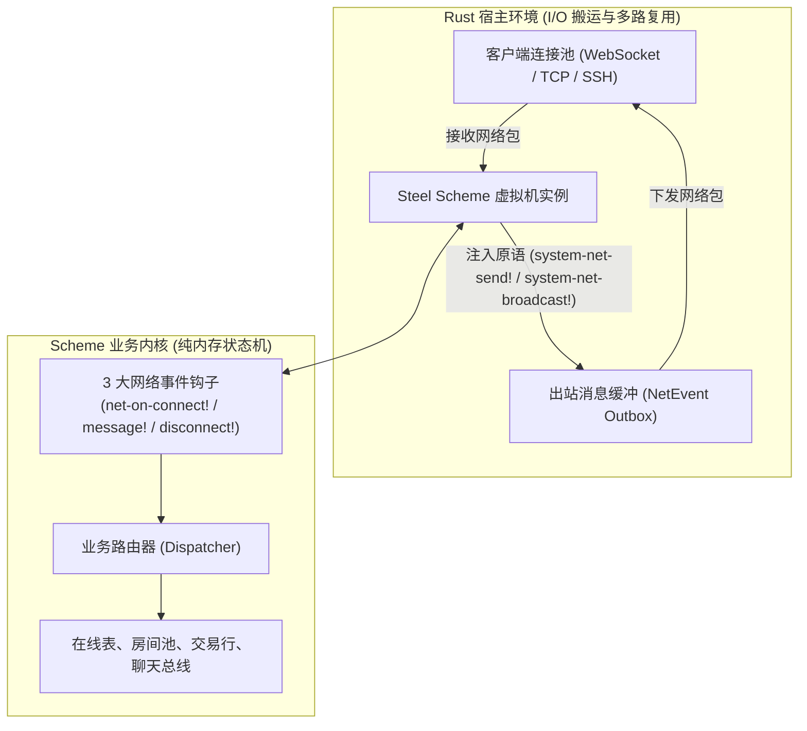
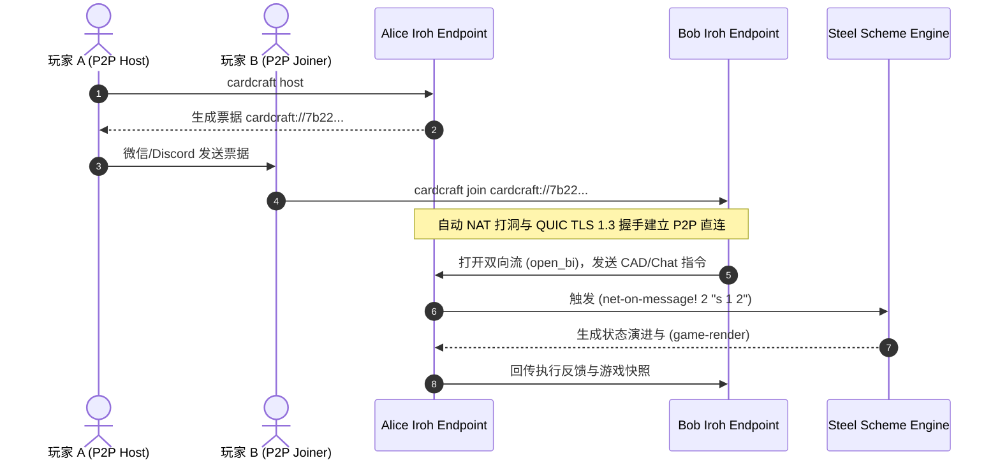

# CardCraft 网络模块技术实现与业务场景指南 (Network Module Guide)

本文档系统性地介绍 CardCraft 的网络模块架构、底层 7 大通信接口，以及基于该接口体系实现的**六大典型网络业务场景**与完整 Scheme 源码实现方法。

---

## 一、 网络模块设计哲学与架构

CardCraft 的网络层采用了 **“Rust 处理并发 I/O，Scheme 全权驱动业务”** 的极简设计。



---

## 二、 底层通信接口定义

网络模块由 **Rust 注入的底层网络原语**（统一归入 `system-*` 命名空间）和 **Scheme 业务钩子** 构成，满足分布式消息传递系统的完备性。

### 1. Rust 注入给 Scheme 的系统网络原语
| 接口函数 | 参数 | 返回值 | 语义与用途 |
| :--- | :--- | :--- | :--- |
| **`(system-net-send! client-id message)`** | `client-id: Integer`<br>`message: String` | `Boolean` | 向指定网络客户端单播发送文本消息（兼容：`net-send!`） |
| **`(system-net-broadcast! message)`** | `message: String` | `Boolean` | 向全服所有当前在线的客户端广播文本（兼容：`net-broadcast!`） |
| **`(system-net-whisper! from to message)`** | `from: Integer`<br>`to: Integer`<br>`message: String` | `Boolean` | 从 `from` 向 `to` 发送私聊消息（兼容：`net-whisper!`） |
| **`(system-net-disconnect! client-id)`** | `client-id: Integer` | `Boolean` | 强制切断指定客户端的网络连接（兼容：`net-disconnect!`） |
| **`(system-time-now)`** | 无 | `Number` | 获取当前自 Unix 纪元起的秒级浮点时间戳（`f64`），用于计算延迟、冷却与超时 |

### 2. Scheme 响应网络事件的 3 大钩子
| 钩子函数 | 参数 | 触发时机与职责 |
| :--- | :--- | :--- |
| **`(net-on-connect! client-id)`** | `client-id: Integer` | 新客户端连入成功时触发。分配默认名称、初始化 Session 并广播入场。 |
| **`(net-on-disconnect! client-id)`** | `client-id: Integer` | 客户端断开/网络异常时触发。注销状态、清理挂起任务并广播退场。 |
| **`(net-on-message! client-id msg)`** | `client-id: Integer`<br>`msg: String` | 收到客户端文本时触发。分发执行聊天、私聊、大厅指令或 CAD 游戏指令。 |

---

## 三、 六大典型网络业务实现场景与源码

得益于 S 表达式与纯函数式列表处理能力，以下所有场景均可 **100% 在 Scheme 脚本层实现**，具备在线热更新能力。

---

### 场景 1：全服公屏聊天与点对点私聊密语 (Public Chat & Whisper/DM)

#### 1. 业务需求
* 玩家使用 `say <msg>` 在公屏发言，所有在线玩家可见。
* 玩家使用 `w <username> <msg>` 发送私人密语，仅发送者和目标接收者双方可见。

#### 2. Scheme 实现方法
```scheme
;; 客户端在线列表: 元素格式为 (client-id username room-id)
(define *net-clients* '())

(define (find-client-by-name name)
  (let loop ([cs *net-clients*])
    (cond
      [(null? cs) #f]
      [(equal? (cadr (car cs)) name) (car cs)]
      [else (loop (cdr cs))])))

;; 在 net-on-message! 中处理：
(cond
  ;; 公共聊天
  [(equal? verb "say")
   (let ([chat-text (join-strings args " ")])
     (system-net-broadcast! (string-append "[" sender-name "]: " chat-text))
     "OK")]

  ;; 私聊密语 (Whisper)
  [(or (equal? verb "w") (equal? verb "tell"))
   (let* ([target-name (car args)]
          [chat-text (join-strings (cdr args) " ")]
          [target (find-client-by-name target-name)])
     (if (not target)
         (begin
           (system-net-send! cid (string-append "Error: User '" target-name "' not found."))
           "User not found")
         (let ([target-cid (car target)])
           ;; 单播发给对方
           (system-net-send! target-cid (string-append "[Private from " sender-name "]: " chat-text))
           ;; 回显给自己
           (system-net-send! cid (string-append "[Private to " target-name "]: " chat-text))
           "OK")))])
```

---

### 场景 2：改名系统与断线重连状态恢复 (Auth & Session Reconnect)

#### 1. 业务需求
* 玩家可以随时使用 `nick <new_name>` 更名，且名字全局唯一。
* 玩家网络波动短时掉线重连后，自动识别其身份，一帧恢复其村庄与卡牌画面。

#### 2. Scheme 实现方法
```scheme
;; 会话持久化表: (token username bound-world last-seen-time)
(define *user-sessions* '())

;; 玩家重连接入: reconnect <token>
(define (handle-reconnect! cid token)
  (let ([session (assoc token *user-sessions*)])
    (if (not session)
        (system-net-send! cid "Error: Invalid session token.")
        (let ([username (cadr session)])
          ;; 更新该会话对应的当前物理 client-id
          (update-net-client-name! cid username)
          (system-net-send! cid (string-append "Welcome back, " username "! Restoring state..."))
          ;; 将当前村庄游戏全景快照精准单播推回给重连者
          (system-net-send! cid (game-render))
          "RECONNECTED"))))
```

---

### 场景 3：多房间大厅与组队隔离 (Lobby & Room System)

#### 1. 业务需求
* 玩家进入大厅后，输入 `create <room_name>` 创建独立房间。
* 其他玩家输入 `join <room_id>` 加入房间。
* 房间内的游戏状态更新只广播给本房间的成员，不同房间彼此互不干扰。

#### 2. Scheme 实现方法
```scheme
;; 房间表: ((room-id name owner (member-cids...) status))
(define *rooms* '())
(define *next-room-id* 101)

;; 向指定房间的所有成员广播消息
(define (room-broadcast! room-id message)
  (let ([r (assoc room-id *rooms*)])
    (when r
      (let ([members (list-ref r 3)])
        (for-each (lambda (cid) (system-net-send! cid message)) members)))))

;; 创建房间
(define (create-room! owner-cid name)
  (let ([rid *next-room-id*])
    (set! *next-room-id* (+ *next-room-id* 1))
    (set! *rooms* (cons (list rid name owner-cid (list owner-cid) "WAITING") *rooms*))
    (system-net-send! owner-cid (string-append "Room " (number->string rid) " created!"))
    rid))

;; 加入房间
(define (join-room! cid room-id)
  (let ([r (assoc room-id *rooms*)])
    (if (not r)
        (system-net-send! cid "Room not found.")
        (let* ([old-members (list-ref r 3)]
               [new-members (cons cid old-members)])
          (set! *rooms*
                (map (lambda (item)
                       (if (equal? (car item) room-id)
                           (list (car item) (cadr item) (caddr item) new-members (list-ref item 4))
                           item))
                     *rooms*))
          (room-broadcast! room-id (string-append "Player " (number->string cid) " joined the room!"))
          "OK"))))
```

---

### 场景 4：自动天梯排队与 1v1 撮合匹配 (Matchmaking Queue)

#### 1. 业务需求
* 玩家输入 `queue` 进入天梯匹配队列。
* 匹配池达到 2 人时，系统自动撮合开赛，生成独立对战房间并推送起始卡牌。

#### 2. Scheme 实现方法
```scheme
;; 撮合等待队列: (cid1, cid2, ...)
(define *match-queue* '())

(define (enqueue-matchmaker! cid)
  (if (member cid *match-queue*)
      (system-net-send! cid "Already in matchmaking queue.")
      (begin
        (set! *match-queue* (append *match-queue* (list cid)))
        (system-net-send! cid "Searching for opponent...")
        (check-and-start-match!))))

(define (check-and-start-match!)
  (when (>= (length *match-queue*) 2)
    (let ([p1 (car *match-queue*)]
          [p2 (cadr *match-queue*)])
      ;; 从队列移出
      (set! *match-queue* (cddr *match-queue*))
      ;; 创建 1v1 对战实例
      (let ([rid (create-room! p1 "1v1 Ranked Match")])
        (join-room! p2 rid)
        (system-net-send! p1 "Match found! You are Player 1 (Red).")
        (system-net-send! p2 "Match found! You are Player 2 (Blue).")
        ;; 触发初始卡牌发放
        (room-broadcast! rid "Game started! Place your first villager.")))))
```

---

### 场景 5：跨岛自由集市与交易行挂单 (Cross-Island Bazaar)

#### 1. 业务需求
* 玩家将自己多余的资源卡上架拍卖行：`list <slot_id> <price>`。
* 买家使用 `buyorder <order_id>` 支付金币，自动完成原子所有权转移。

#### 2. Scheme 实现方法
```scheme
;; 挂单表: ((order-id seller-cid card-name price status))
(define *market-orders* '())
(define *next-order-id* 1)

;; 上架卡牌
(define (market-list! cid slot-id price)
  (let ([stack (find-stack slot-id)])
    (if (not stack)
        (system-net-send! cid "Invalid slot.")
        (let* ([cards (stack-cards stack)]
               [card-name (car cards)])
          ;; 扣除本地卡槽卡牌
          (remove-stack slot-id)
          (let ([oid *next-order-id*])
            (set! *next-order-id* (+ *next-order-id* 1))
            (set! *market-orders* (cons (list oid cid card-name price "OPEN") *market-orders*))
            (system-net-broadcast! (string-append "[Market] " card-name " listed for " (number->string price) "G by Player " (number->string cid)))
            "OK")))))

;; 购买挂单
(define (market-buy! buyer-cid order-id)
  (let ([order (assoc order-id *market-orders*)])
    (cond
      [(not order) (system-net-send! buyer-cid "Order does not exist.")]
      [(not (equal? (list-ref order 4) "OPEN")) (system-net-send! buyer-cid "Order already sold.")]
      [else
       (let ([seller-cid (cadr order)]
             [card-name  (caddr order)]
             [price      (cadddr order)])
         ;; 校验买家金币，原子结算
         (if (< *world-gold* price)
             (system-net-send! buyer-cid "Insufficient gold!")
             (begin
               (set! *world-gold* (- *world-gold* price))
               ;; 生成卡牌入买家槽位
               (spawn-card! card-name)
               ;; 标记订单售出
               (set-order-status! order-id "SOLD")
               ;; 通知双方
               (system-net-send! seller-cid (string-append "Your " card-name " was sold! Received " (number->string price) "G."))
               (system-net-send! buyer-cid (string-append "Successfully purchased " card-name "!"))
               "OK")))])))
```

---

### 场景 6：心跳保活、滑动窗口防刷屏与作弊踢出 (Rate Limiting & Anti-Cheat)

#### 1. 业务需求
* 防止恶意客户端 DDOS 轰炸指令：每秒限制发送最多 5 条消息，超额警告，多次违规自动 `(system-net-disconnect!)`。
* 超过 10 分钟无输入的挂机玩家自动清理断连。

#### 2. Scheme 实现方法
```scheme
;; 客户端风控画像: ((cid last-msg-time msg-count-in-sec warning-count))
(define *rate-limit-table* '())

(define (check-rate-limit! cid)
  (let* ([now (system-time-now)]
         [record (assoc cid *rate-limit-table*)])
    (if (not record)
        (begin
          (set! *rate-limit-table* (cons (list cid now 1 0) *rate-limit-table*))
          #t)
        (let ([last-time (cadr record)]
              [count     (caddr record)]
              [warnings  (cadddr record)])
          (if (< (- now last-time) 1.0)
              ;; 1 秒以内多次发送
              (if (> count 5)
                  (if (>= warnings 3)
                      (begin
                        (system-net-send! cid "Kicked for spamming.")
                        (system-net-disconnect! cid)
                        #f)
                      (begin
                        (system-net-send! cid "Warning: You are typing too fast!")
                        ;; 警告次数增加
                        (update-rate-record! cid last-time (+ count 1) (+ warnings 1))
                        #f))
                  (begin
                    (update-rate-record! cid last-time (+ count 1) warnings)
                    #t))
              ;; 超过 1 秒，重置计数器
              (begin
                (update-rate-record! cid now 1 warnings)
                #t))))))
```

---

## 四、 Rust 宿主单测与无头模拟

开发网络业务逻辑时，开发者**不需要启动真实的 TCP 端口**，可以直接在 Rust 单测中通过 `GameEngine` 提供的纯内存测试 API 完成 100% 自动化验证：

```rust
#[test]
fn test_chat_and_whisper_flow() {
    let mut engine = GameEngine::new().unwrap();

    // 1. 模拟网络连接
    engine.net_connect(1).unwrap();
    engine.net_connect(2).unwrap();

    // 2. 模拟客户端发送指令
    engine.net_message(1, "nick Alice").unwrap();
    engine.net_message(2, "nick Bob").unwrap();

    // 3. 模拟私聊
    engine.net_message(1, "w Bob Secret trade offer").unwrap();

    // 4. 验证出站网络事件
    let events = engine.drain_net_events();
    assert_eq!(events, vec![
        NetEvent::Send { client_id: 2, message: "[Private from Alice]: Secret trade offer".to_string() },
        NetEvent::Send { client_id: 1, message: "[Private to Bob]: Secret trade offer".to_string() }
    ]);
}
```

---

## 五、 Iroh P2P 直连网络架构 (Zero-Server P2P Gaming)

CardCraft 现已原生集成 **Iroh P2P (QUIC)** 网络通信模块（`src/p2p.rs`），支持**零服务器、零公网 IP、跨家庭路由器自动打洞穿透（NAT Traversal）的端到端联机对战**。

### 1. Iroh P2P 的技术优势
* **加密公钥身份（Ed25519 NodeId）**：每个玩家自动拥有唯一的加密身份，无需注册账号；
* **自动 NAT 打洞（Hole Punching & DERP Relays）**：通过 QUIC + STUN + 动态中继，处于不同家庭局域网/防火墙后的玩家可直接建立高速点对点直连；
* **极简 Ticket 分享机制**：房主生成一段 `cardcraft://...` 票据文本，好友复制该票据即可秒连。



### 2. CLI 快速使用指南

* **作为房主启动 P2P 服务 (Host)**：
  ```bash
  cargo run -- host
  # 或者
  cardcraft --p2p-host
  ```
  终端将打印出专属直连票据：
  ```text
  === CardCraft Iroh P2P Host Starting ===
  [P2P Host Ready!]
  Share this ticket with your friend to connect without any central server or public IP:
    cardcraft://7b226964223a22...
  Waiting for peer connection...
  ```

* **作为客方加入好友对局 (Join)**：
  ```bash
  cargo run -- join cardcraft://7b226964223a22...
  # 或者
  cardcraft --p2p-join cardcraft://7b226964223a22...
  ```
  两端将通过 Iroh QUIC 直连握手，在同一张卡牌村庄中协同对战！

---

## 六、 总结与最佳实践

1. **零外部锁竞争**：
   由于网络业务都在单线程 Scheme 内部求值，状态读写天然具备原子性，无需编写复杂的互斥锁（Mutex）死锁排查。
2. **传输层全协议可插拔**：
   上层 Scheme 只与抽象 `client-id` 交互，底层无论是 Iroh P2P、WebSocket 还是 SSH，完全无缝切换。
3. **文本协议透明可读**：
   所有通信报文为直观的字符串或 S-表达式，无论服务端开发还是抓包调试均一目了然。
4. **极佳的热运维能力**：
   在服务器运行期间，管理员可以通过控制台动态加载新配方或修改聊天过滤规则，无需停服即可热生效。
